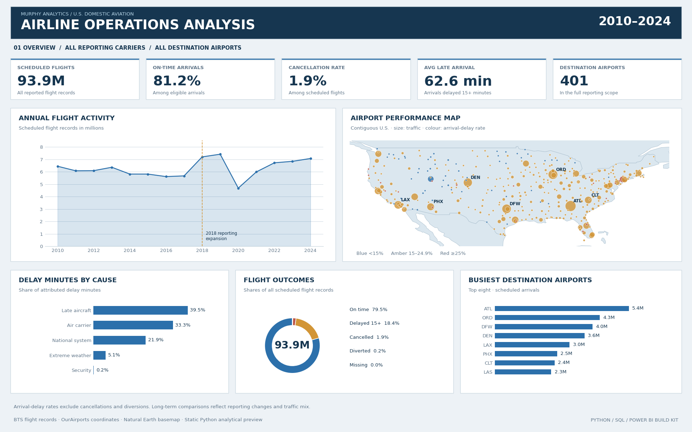
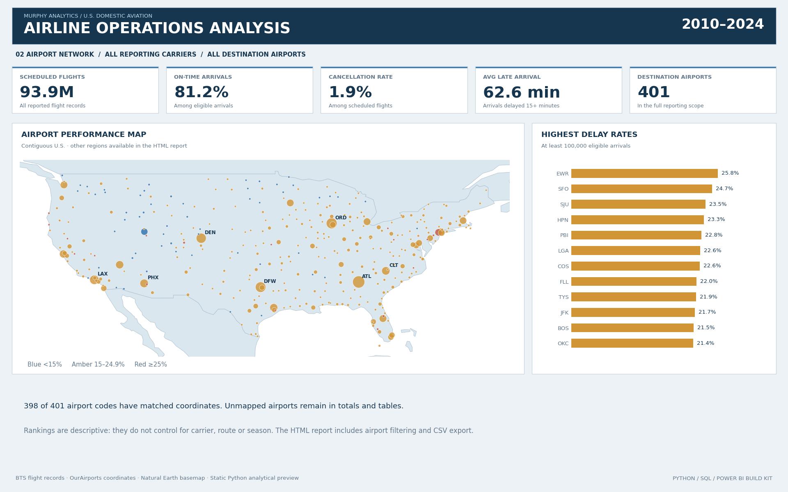
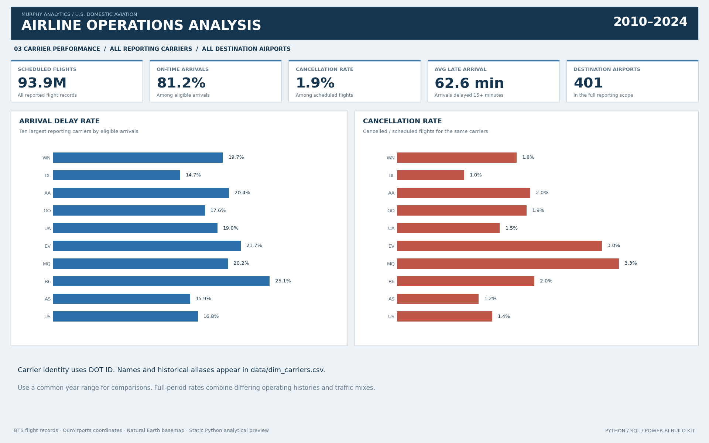
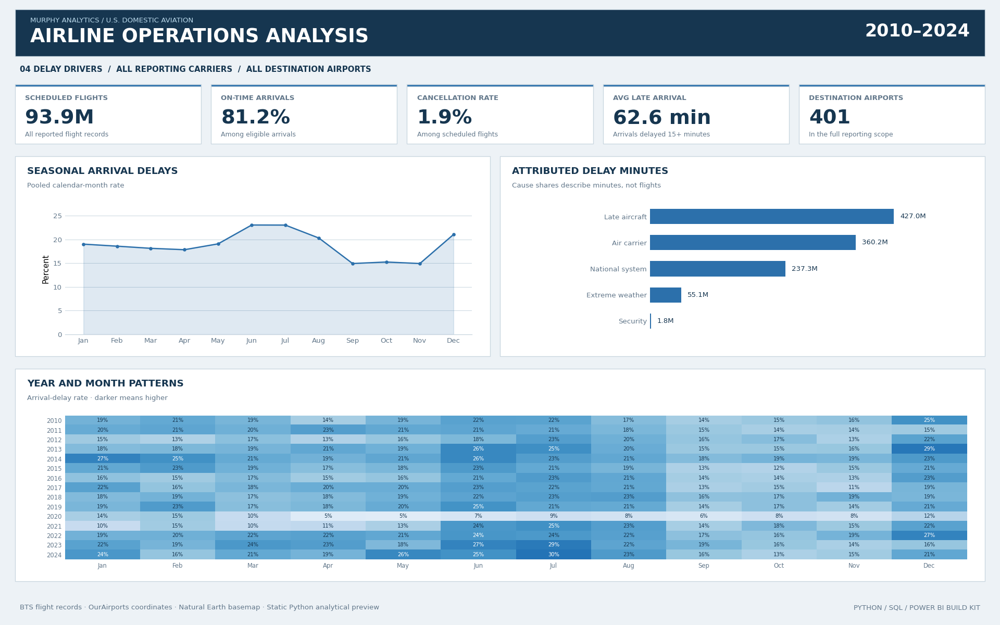

# Airline Operations Analysis — 2010–2024

**93,900,879 real flight records · 15 years · Python · SQL · Power BI build kit**



---

## Business question

How have airline reliability, airport performance and delay causes changed, and where should an operations team investigate recurring disruption?

## Data scope

All 180 monthly BTS Reporting Carrier On-Time Performance files, January 2010–December 2024. The complete delivered aggregate has **253,181 rows**, **401 airports** and **24 DOT carrier identities**. Grain: month × reporting-carrier DOT ID × scheduled destination airport. No synthetic flight data.

The 1,000-row `data/flight_sample.csv` is an inspection sample only. All findings use the complete aggregate table. Original source URLs, hashes and row counts are in `data/source_manifest.json`.

## Findings

- 81.2% of eligible arrivals were on time; 18.8% were delayed by at least 15 minutes. Cancellations were 1.9% of scheduled flight records.
- Delayed eligible arrivals averaged 62.6 minutes late. This excludes on-time, cancelled and diverted flights.
- Reported traffic changed by -36.8% in 2020 versus 2019. In 2024, volume was -4.6% relative to 2019; the delay rate changed by +1.7 percentage points.
- Late aircraft accounted for 39.5% of attributed delay minutes, the largest recorded category.
- June had the highest pooled calendar-month delay rate (23.0%); November had the lowest (14.9%).
- Among airports with at least 100,000 eligible arrivals across the full period, EWR had the highest delay rate (25.8%). Rankings are not adjusted for traffic mix.

## Recommendations

Investigate persistent disruption at high-volume airports, review the largest recorded delay-minute categories and validate seasonal staffing within individual airports and carriers. Use the matched 2019–2024 airport cohort when assessing recovery. The analysis is descriptive, not causal.

---

## Dashboard

Extract the project and open [dashboard/index.html](dashboard/index.html) locally. GitHub displays HTML source; download the project to use its interactive report.

- **Overview:** activity trend, airport map, flight outcomes, busiest airports and cause shares.
- **Airport Network:** enlarged map, clickable airport markers, monthly trend, volume threshold and CSV export.
- **Carrier Performance:** delay and cancellation comparisons.
- **Delay Drivers:** seasonality, cause minutes and year/month heatmap.

Year, carrier and airport filters apply across pages. Map-region selection changes the viewport only. Alaska, Hawaii and territories have separate map views. PNGs are Python analytical previews.

<details><summary>Additional previews</summary>







</details>

## Skills demonstrated

| Tool | Demonstrated work |
|---|---|
| Python | Resumable downloads, chunked processing, validation, coordinate joins, notebook analysis and reporting |
| SQL | Indexed SQLite model, joins, CTEs, LAG, rolling windows, ranking and weighted rates |
| Power BI build kit | Power Query imports, model relationships, DAX time comparisons, map setup and theme |
| Dashboard | Offline SVG map, linked filters, four views, tooltips and CSV export |

**Power BI status:** M, DAX, theme and build guide are supplied. No native `.pbix` is included, and Power BI Desktop execution is not verified. The completed interactive dashboard is HTML.

---

## Reproduce

Requires Python 3.11+.

```bash
python -m pip install -r requirements.txt
python python/run_all.py
```

This rebuilds from the complete included aggregate dataset. To reproduce from flight-level sources:

```bash
python python/ingest.py --workers 6
python python/run_all.py
```

The source download requires several GB and substantial time. Valid completed months are reused. Raw archives, monthly intermediates and the rebuildable SQLite database are excluded from Git and the delivered ZIP.

```bash
python -m unittest discover -s tests -v
```

See `reports/validation.txt` for reconciliation evidence and `python/analysis.ipynb` for executed analysis.

## Definitions

Eligible arrivals exclude cancellations, diversions and missing arrival times. Delayed means arrival at least 15 minutes late. On-time rate is (eligible − delayed) / eligible. Cancellation rate is cancelled / scheduled. Average late arrival uses delayed eligible flights only. Cause shares describe attributed minutes, not flights. All rates use summed numerators and denominators; percentages are not averaged across groups.

## Project structure

| Folder | Contents |
|---|---|
| `data/` | Complete fact table, dimensions, manifest and coordinate snapshots |
| `python/` | Reproducible scripts and executed notebook |
| `sql/` | Eight analytical queries |
| `dashboard/` | Offline report and editable template |
| `reports/` | Previews, findings, SQL results and validation |
| `powerbi/` | M, DAX, model and theme |
| `docs/` | [Project handbook](docs/Project_Handbook.docx) and [Power BI guide](docs/PowerBI_Build_Guide.docx) |
| `tests/` | Metric boundary checks |

---

## Limitations

Reporting expanded in 2018; mergers, coverage and traffic mix also change over time. Reported traffic is not a constant-coverage market census. Marketing-carrier records are not mixed into this series. Rankings are unadjusted for traffic mix. Extreme-weather minutes are not the full weather impact. Missing cause values contribute no attributed minutes. Current airport coordinates do not capture historical relocations; unmatched airports remain in totals. The analysis does not establish passenger volume, revenue or profitability.

## Sources and licence

- [BTS dataset and definitions](https://transtats.bts.gov/DatabaseInfo.asp?DB_URL=&QO_VQ=EFD)
- [BTS 2018 reporting change](https://www.bts.gov/topics/airlines-and-airports/lists-reporting-air-carriers-and-reportable-airports-time-performance)
- [OurAirports coordinates and terms](https://ourairports.com/data/)
- [Natural Earth terms](https://www.naturalearthdata.com/about/terms-of-use/)
- [Power Query decompression](https://learn.microsoft.com/en-us/powerquery-m/binary-decompress)
- [Azure Maps markers](https://learn.microsoft.com/en-us/azure/azure-maps/power-bi-visual-add-bubble-layer)

Original code and documentation use the MIT licence. BTS data retain their U.S. federal status; OurAirports and Natural Earth data are public domain. No source-agency endorsement is implied.
